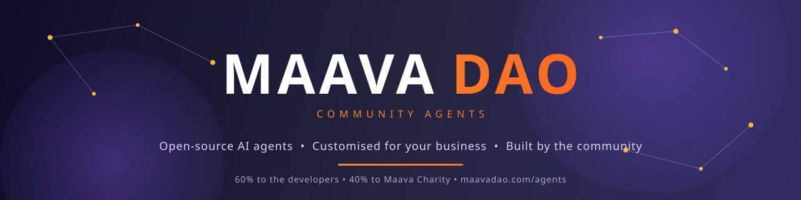

### Open-source AI agents for sales, marketing and growth. Built by the community. Free for education.

&nbsp;&nbsp;
&nbsp;&nbsp;
&nbsp;&nbsp;

## What this organisation is for

This is the home of the **maava Community Agents**: a fully open-source suite of AI agents for
sales, marketing and growth, customised for each business that uses them.

We don't build from scratch. We take proven open-source agent projects, make them better for
businesses, and share the profit: **60% of what an agent earns goes to the developer community
who built it, and 40% goes to Maava Charity**, which educates deserving children, orphans and
street children. Agents are always free for schools, colleges, universities, teachers and students.

Every agent is its own public repository here, so anyone can read it, fork it, improve it or
add a new one. It's part of [maavaDao](https://github.com/maavadao), the community-governed
AI and blockchain project for education.

## The agents

Start at [**maava-Community-Agents**](https://github.com/Maava-Community-Agents/maava-Community-Agents),
the index repo. It holds the rules, the contributing guide, the agent template and SDK, and each
agent as a submodule. The full list is on [maavadao.com/agents](https://maavadao.com/agents).

| Agent | What it does |
| --- | --- |
| [Claim Checker](https://github.com/Maava-Community-Agents/community-agent-claim-checker) | Checks claims against sources |
| [Compliance Agent](https://github.com/Maava-Community-Agents/community-agent-compliance-agent) | Flags compliance issues before you publish |
| [Content Research Agent](https://github.com/Maava-Community-Agents/community-agent-content-research-agent) | Researches a topic for creators |
| [Content Writer Agent](https://github.com/Maava-Community-Agents/community-agent-content-writer-agent) | Turns an approved outline into a first draft |
| [Content Review Agent](https://github.com/Maava-Community-Agents/community-agent-content-review-agent) | Checks facts, tone, accessibility and copyright |
| [Dependency Doctor](https://github.com/Maava-Community-Agents/community-agent-dependency-doctor) | Finds vulnerable dependencies and what to upgrade first |
| [Law Agent](https://github.com/Maava-Community-Agents/community-agent-law-agent) | Explains laws and rights in plain language, with sources |
| [Planting Advisor](https://github.com/Maava-Community-Agents/community-agent-planting-advisor) | Tells farmers and gardeners when to sow, water and protect a crop |

## Get involved

- **Build an agent:** read the [rules](https://github.com/Maava-Community-Agents/maava-Community-Agents/blob/main/RULES.md) and the [contributing guide](https://github.com/Maava-Community-Agents/maava-Community-Agents/blob/main/CONTRIBUTING.md), then start from the template.
- **Improve one:** open an issue or a pull request on any agent.
- **Vote on what we build next:** [maavadao.com/vote](https://maavadao.com/vote).

 

